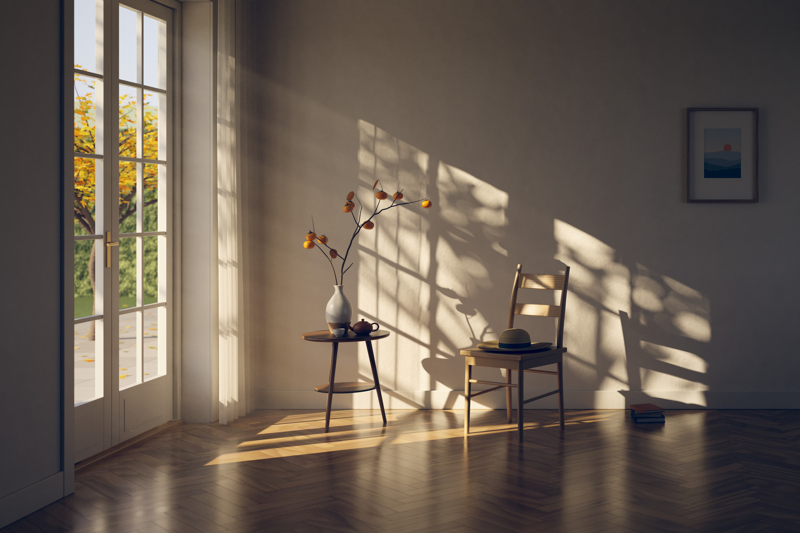

# Afternoon Light · 午后

English | [中文](README.zh-CN.md)

[](afternoon_light.png)

A still image computed entirely by code: a quiet room on a late-autumn afternoon, with low sun coming through a French door and laying window-grid light and leaf shadows across a white wall and a herringbone floor.

- Final image: [`afternoon_light.png`](afternoon_light.png) (3840 × 2560, 8-bit sRGB)
- Preview: [`preview.jpg`](preview.jpg) (1920 × 1280)

No image-generation model, no photos, no texture images, no pre-made 3D models, and no off-the-shelf 3D software or render engine were used. The renderer is itself a small piece of 3D software, written from scratch for this one picture. The code was written by Claude, an AI model (`claude-fable-5-2`); the image was computed by that code.

## What the picture shows

One corner of a quiet, empty room. The camera faces the back wall head-on (one-point perspective, verticals kept vertical).

- **Light.** The sun is 24° above the horizon and comes in through the French door on the left. It throws a slanted window grid onto the back wall and a warm strip across the floor. A tree outside the frame adds leaf shadows on top of the grid. Leaves far from the wall cast soft shadows; the window bars close to the wall cast sharp ones.
- **Sheer curtain.** A thin curtain hangs by the corner. Where the sun hits it, it glows, and the shadows of the window bars fall on it. Sunlight that passes through it becomes the first, softer column of stripes on the wall.
- **Still life.** A three-legged side table holds a dipped-glaze vase with a persimmon branch, a small Yixing clay teapot and a white porcelain cup. To the right is a ladder-back chair with a straw hat on the seat. Three stacked books sit by the wall, and a small print hangs above.
- **Outside.** An autumn maple, fallen leaves on a stone terrace, a hedge, a distant tree line and a pale blue sky.
- **Air.** Faint light shafts and a few dust motes in the beam.
- **Warm and cool.** The sunlight is warm. A second window in the right wall, outside the frame, lets in only skylight and fills the shadows with cooler light.

## How it was made

Geometry, materials and lighting are all computed by the code in this directory. The post-processing script uses three general-purpose libraries: numpy, scipy and Pillow.

**Renderer (C++17, a single translation unit, `src/`)**

- `core.h`: vector math, PCG random numbers, correlated multi-jittered (CMJ) sampling, Perlin/fBm noise.
- `geom.h`: triangle mesh, procedural modelling tools (rounded box, swept tube, lathe, Catmull-Rom refinement), binned-SAH BVH.
- `scene.h`: the whole scene, modelled in code (368,156 triangles), and every material as a procedural function: herringbone floor (per-plank grain, tone variation, gaps, slight tilt), plaster wall, dipped glaze, clay, woven straw, sheer fabric (stochastic transparency whose openness depends on the angle of incidence), translucent leaves.
- `main.cpp`: a unidirectional path tracer.
  - The sun is an area light with an angular radius of 0.30° (the real sun is about 0.27°), so penumbra width follows from the distance to the occluder. It is sampled with next-event estimation and combined with BSDF sampling by multiple importance sampling (MIS).
  - Skylight is importance-sampled through two portals: the French door and the fill window.
  - Light bounced off the sunlit patch on the wall and floor is additionally sampled from the light side: a point is picked on the door opening, followed along the sun direction to the surface it lights, and connected to every path vertex as a virtual point light, with MIS against ordinary path tracing. Measured on this scene, that light is only 7–9% of the indirect illumination and the technique reduces error by only 3–9%. What actually keeps the noise down is the roughness regularisation below and the denoiser.
  - Coated diffuse materials with a GGX microfacet layer, thin translucent materials, and roughness regularisation after diffuse bounces (which suppresses fireflies from glossy caustics).
  - Thin-lens depth of field (very slight), tent pixel filter, single-scattering light shafts along primary rays, and visibility tests for dust motes.
  - Output: linear floating-point buffers for beauty, direct sun, albedo, normal, depth, light shafts, and a list of dust motes.

**Darkroom (Python with numpy, scipy and Pillow, `src/develop.py`)**

- Only the indirect light is denoised. It is divided by albedo, then filtered with an à-trous wavelet filter guided by normal, depth and albedo. The direct-sun layer, which holds the sharp shadows, is left untouched.
- Denoised light shafts, splatted dust motes and a faint bloom are added.
- Filmic tone curve, a slight warm/cool split grade, vignette, fine grain and dither, then 8-bit sRGB output.

## Rendering it yourself

You need a C++17 compiler (`c++`, clang or gcc) and Python 3 with `numpy`, `scipy` and `Pillow`.

```sh
./render.sh              # final: 3840×2560, 400 samples per pixel
./render.sh 64 1920      # quick look: 64 spp at 1920×1280, a few minutes
```

The script compiles `src/main.cpp`, writes intermediate buffers to `work/`, then runs `src/develop.py` to produce `afternoon_light.png` and `preview.jpg`.

- **Determinism.** Seeds are fixed. Two runs of the renderer with the same arguments on the same machine produced byte-identical buffers.
- **Time.** The published image took 3041 seconds (about 51 minutes) to render on a 16-core Apple M4 Max MacBook Pro that was busy with other jobs, plus about 1.5 minutes of post-processing.
- **Disk.** The intermediate buffers in `work/` take about 900 MB and can be deleted afterwards.
- **Not verified.** `render.sh` was run end to end only at a small size (16 spp, 480 px wide). The full-size image was produced by running its two commands separately.

Environment variables: `SUN_AZ` and `SUN_EL` (sun azimuth and elevation, default 30 and 24), `TREE_SEED`, `TREE_Y`, `TREE_Z`, `TREE_R` (the tree that casts the dappled shade), and `NT` (thread count).

## Assets and credits

No third-party assets: no textures, models, photos or fonts. Everything in the picture, including the small print on the wall, is generated by the program.

Several small routines follow published algorithms and their reference code closely: Kensler's CMJ sampling, Heitz's sampling of the GGX distribution of visible normals, the orthonormal basis of Duff et al., the PCG random number generator, and Perlin noise. The denoiser follows the à-trous approach of Dammertz et al.

## Known shortcomings

The upper half of the image and the main areas of the lower half (door and garden, curtain, still life, chair and hat, books, the print, the large shadowed wall, part of the floor) were inspected at 100% pixel size. The floor in the foreground was not fully covered. No banding, seams, light leaks or floating objects were found, and no pixel is clipped to pure white or pure black. An automated check found about 30 isolated single-pixel bright specks on the dark wall at the right. They are most likely residual noise and are not visible at normal viewing size.

- **No glass in the door.** The panes are empty, so there are no reflections and no slight tint.
- **The far background is flat.** The maple and the fallen leaves are real geometry, but the hedge and the distant tree line are flat planes with procedural textures.
- **The curtain is a formula, not a cloth simulation.** The folds are fairly regular and the hem is a straight line.
- **The shadowed wall is smoothed by the denoiser.** The image is 400 samples per pixel plus denoising, not brute-force converged. The fine plaster relief shows mainly in the sunlit areas.
- **Light shafts and dust are very restrained.** The shafts are barely visible and there are only a few motes, so they are not mistaken for noise.
- **No caustics.** Glossy reflection is roughened after a diffuse bounce to remove fireflies, so the floor does not throw a bright patch of reflected sun onto the wall, and the tea and the cup cast no caustic highlights.
- **Some props are simple.** The persimmon sepals and dry leaves, the weave of the hat, the books and the chair's wood grain do not hold up in close-up. The grain on a few floor planks looks a little regular at 100%.
- **The composition is sparse.** The empty wall at the upper right is deliberate, but the picture has little narrative content.
- **Physical simplifications.** The sky is a hand-written gradient, not an atmospheric scattering model. Leaves and sheer fabric use thin diffuse transmission only. The lens has no chromatic aberration or flare.
