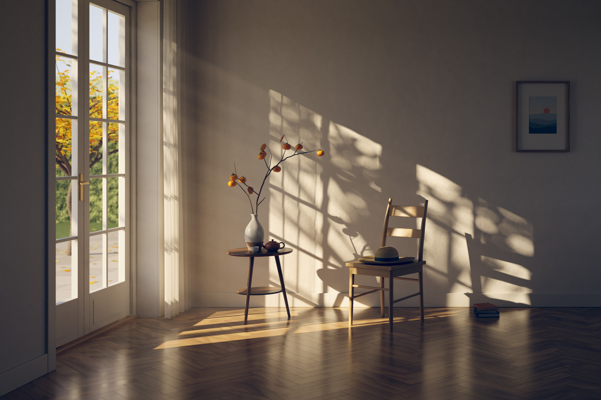

# 午后 · Afternoon Light

[English](README.md) | 中文

[](afternoon_light.png)

一幅完全由代码生成的静态画作：深秋午后，斜阳穿过法式落地门，把窗棂和院中树叶的影子投在白墙与人字拼木地板上。

- 成品：[`afternoon_light.png`](afternoon_light.png)（3840 × 2560，8-bit sRGB）
- 预览：[`preview.jpg`](preview.jpg)（1920 × 1280）

## 画的是什么

一间安静的空房间的一角，镜头平视后墙（一点透视，竖线保持垂直）。

- **光**：太阳高度角 24°，从左侧的落地门斜射进来，在后墙上投下一片倾斜的窗格光斑，并沿着地板拉出一条暖色的光带。门外（画面外）有一棵树，它的叶影叠在窗格影子上——离墙远的树叶影子发虚，离墙近的窗棂影子锐利，两种软硬不同的影子交错在一起。
- **纱帘**：门靠墙角的一侧挂着一幅薄纱，被太阳直射的部分透亮，窗棂的影子落在纱上；穿过纱的阳光变成墙上第一列柔和的条纹。
- **静物**：三脚小圆几上是一只蘸釉陶瓶，插着柿子枝；旁边一把紫砂小壶、一只白瓷茶杯。右边一把梯背木椅，椅面上搁着一顶草帽；墙根有三本摞着的书，墙上一幅小画。
- **门外**：一棵秋天的槭树、落在石板露台上的叶子、绿篱、远处的树线和淡蓝的天。
- **空气**：光柱里有很淡的体积光和零星的浮尘。
- **冷暖**：阳光是暖的；画面外右墙上还有一扇只进天光的窗，给阴影补了一层偏冷的光。

## 技术

没有用任何现成的渲染引擎或三维软件，没有用贴图图片、现成的三维模型或 AI 生图模型；几何、材质、光照都是这个目录里的代码算出来的（渲染器本身就是为这幅画写的一个小型三维渲染程序），后期脚本用了 numpy、scipy、Pillow 这几个通用库。

**渲染器（C++17，单文件编译，`src/`）**

- `core.h`：向量数学、PCG 随机数、CMJ 相关多重抖动采样、Perlin/fBm 噪声。
- `geom.h`：三角网格、程序化建模工具（圆角盒、放样管、车削回转体、Catmull-Rom 细分）、SAH 分箱 BVH。
- `scene.h`：整个场景的程序化建模（约 37 万个三角形）与全部程序化材质——人字拼地板（逐块木纹、色差、缝隙、微小倾斜）、抹灰墙、蘸釉陶、紫砂、草编、薄纱（开孔率随入射角变化的随机透明）、半透明树叶等。
- `main.cpp`：单向路径追踪。
  - 太阳是有角直径的面光源（半径 0.30°），所以半影宽度随遮挡物距离自然变化；对太阳做下一事件估计并与 BSDF 采样做 MIS。
  - 天光通过两个“门户”（落地门、补光窗）做引导采样。
  - 墙和地板上那块光斑反弹出的光，另外从光源一侧采样：在门洞上取点、沿阳光方向找到被照亮的点，作为虚拟点光源与每个路径顶点连接，再和正向路径做 MIS。实测这部分只占间接光的 7–9%，这个方法只把误差降低了 3–9%；真正压住噪点的是下面的粗糙度正则化和后期降噪。
  - GGX 微表面 + 漫反射的涂层材质、薄片半透明材质、漫反射后的粗糙度正则化（抑制光泽焦散的萤火虫噪点）。
  - 薄透镜景深（很小）、帐形像素滤波、主光线上的单次散射体积光、浮尘粒子的可见性计算。
  - 输出线性浮点 AOV：beauty、太阳直射、反照率、法线、深度、体积光、浮尘列表。

**暗房（Python / numpy / scipy / Pillow，`src/develop.py`）**

- 只对“间接光”降噪：先除以反照率，再用法线/深度/反照率引导的 à-trous 小波滤波，太阳直射层（锐利的影子）不动。
- 体积光降噪后叠加、浮尘溅射、微弱的辉光。
- 胶片式色调映射、轻微的冷暖分离调色、暗角、细颗粒与抖动，输出 8-bit sRGB。

## 怎么重新渲染

需要：一个 C++17 编译器（`c++`/clang/gcc）、Python 3 以及 `numpy`、`scipy`、`Pillow`。

```sh
./render.sh              # 成品：3840×2560，400 spp
./render.sh 64 1920      # 快速小样：64 spp，1920×1280，几分钟
```

脚本会编译 `src/main.cpp`，把中间缓冲写到 `work/`，再调用 `src/develop.py` 生成 `afternoon_light.png` 和 `preview.jpg`。渲染是确定性的（固定种子）：同一台机器上用相同参数跑两次渲染器，输出逐字节一致。`render.sh` 只在小尺寸（16 spp、480 宽）下完整跑通过，成品是分两步手动执行其中两条命令得到的。
成品这一版在一台同时跑着别的任务的 16 核 Apple M4 Max 上渲染用时 3041 秒（约 51 分钟），后期约 1.5 分钟；机器空闲时会更快。`work/` 里的中间缓冲约 900 MB，出图后可以删掉（交付时已删）。

可调的环境变量：`SUN_AZ`、`SUN_EL`（太阳方位/高度角，默认 30/24）、`TREE_SEED`、`TREE_Y`、`TREE_Z`、`TREE_R`（院中那棵投影的树）、`NT`（线程数）。

## 素材来源

无。没有使用任何第三方贴图、模型、照片或字体；画面里的一切（包括墙上那幅小画）都是程序生成的。
用到的公开算法：Kensler 的 CMJ 采样、Heitz 的 GGX 可见法线分布采样、Duff 等的正交基构造、PCG 随机数、Perlin 噪声、Dammertz 等的 à-trous 降噪思路。

## 已知不足（自评）

成品的上半幅和下半幅的主要区域（门与门外、纱帘、静物、椅子与草帽、书、挂画、大面积阴影墙面、部分地板）在 100% 像素下看过，地板前景没有完全覆盖；没有发现色带、接缝、漏光、悬空物体或过曝死黑（统计上没有任何像素被裁切到纯白或纯黑）。自动检查在右侧暗墙上找到约 30 个孤立的单像素亮点，应是残留噪点，正常观看看不出来。离“极致”还有这些差距：

- **门上没有玻璃**。窗格是空的，所以没有玻璃的反光和轻微的色偏，懂行的人能看出来。
- **门外的远景是贴了程序纹理的平面**。槭树、落叶是真实几何，但绿篱和远处树线只是带凹凸的平板，放大看比较“平”。
- **纱帘是公式生成的褶皱，不是布料模拟**。褶子偏规整，下摆是一条直线，没有真实布料的垂坠和不规则。
- **阴影里的墙面被降噪抹得偏平滑**。成品是 400 spp 加降噪，不是硬算到收敛；抹灰的细微起伏主要在受光处可见，暗部质感偏“干净”。
- **体积光和浮尘很克制**。光柱只在门与墙之间隐约可见，浮尘只有零星几颗，缩略图里基本看不出来；这是为了不被误认成噪点而做的取舍。
- **没有焦散**。为了压掉萤火虫噪点，漫反射之后的光泽反射被加粗糙了，所以地板把阳光反到墙上的那种亮斑、茶汤和瓷杯的高光焦散都没有。
- **部分物件建模偏简**。柿子的萼片和枯叶、草帽的编织纹、书（没有书名和细节）、椅子的木纹都经不起特写；地板个别木条的纹理在 100% 下略显规则。
- **构图偏空**。右上大片墙面是有意的留白，但也可以说画面内容偏少、叙事性不强。
- **物理上的简化**：天空是手写的渐变而非大气散射模型；树叶和纱只做了薄片漫透射；镜头没有色差、眩光等真实光学瑕疵。
